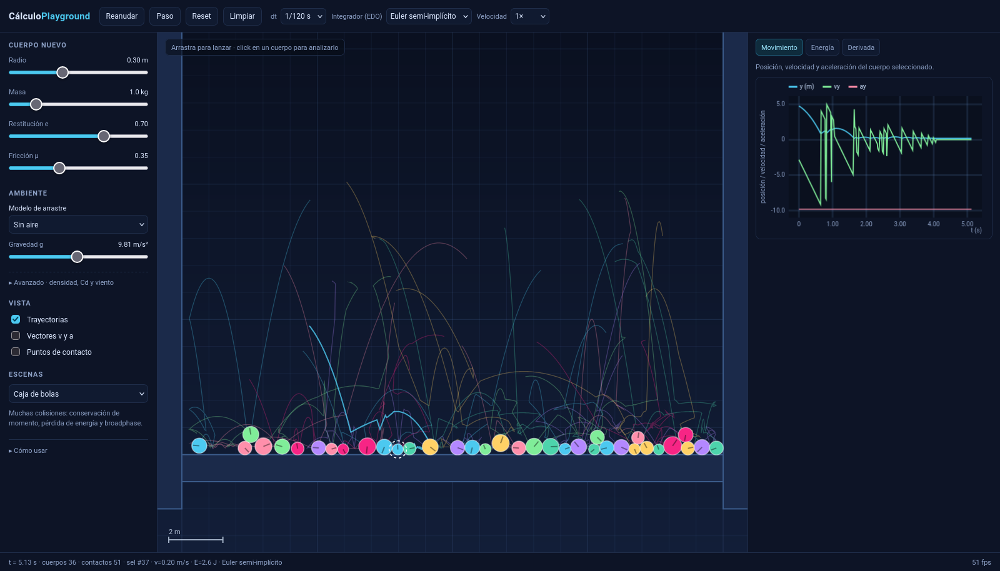
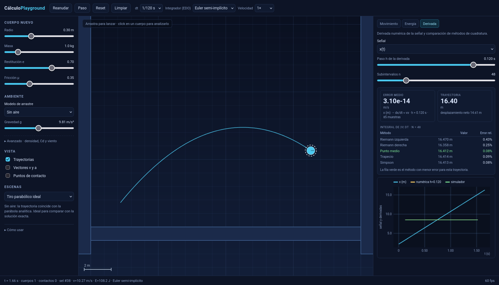

# Playground de cálculo · Física 2D

Sandbox de física 2D en TypeScript y Canvas que funciona como laboratorio visual de
cálculo diferencial e integral. Lanzas círculos, observas trayectorias, colisiones,
fricción y arrastre atmosférico, y al mismo tiempo analizas derivadas numéricas y
cuadraturas. La convergencia de integradores se conserva como validación interna.

Motor de física escrito desde cero, sin librerías externas. La interfaz está en español.



## Documentación

- [**Conceptos y cálculos**](docs/CONCEPTOS.md): modelo físico, EDO, integradores,
  colisiones, arrastre, derivación, cuadratura, muestreo, convergencia, presets,
  validación y limitaciones.

## Características

### Simulación

- Círculos dinámicos con rotación (ruedan por rampas y plataformas).
- Obstáculos estáticos construidos con segmentos y polígonos: suelo, paredes,
  rampas, plataformas y cuñas.
- Gravedad configurable, restitución, fricción de Coulomb y resistencia a la
  rodadura.
- Arrastre atmosférico lineal o cuadrático, con densidad, coeficiente de arrastre
  `Cd` y viento horizontal.
- Colisiones círculo–círculo y círculo–segmento con impulso normal, fricción
  tangencial y corrección posicional.
- Substepping adaptativo para evitar tunneling con velocidades altas.
- Lanzamiento mediante slingshot con trayectoria fantasma (predicción sin
  colisiones).
- Trazas, vectores de velocidad y aceleración, y puntos de contacto.
- Presets didácticos: tiro parabólico, atmósfera, velocidad terminal, rebotes,
  rampa con fricción, caja de bolas y circuito de obstáculos.

### Herramientas de cálculo

- **Derivada numérica** por diferencia central sobre la señal registrada, con
  slider de `h` y comparación contra la derivada del simulador.
- **Cuadraturas** de Riemann (izquierda, derecha), punto medio, trapecio y
  Simpson para estimar la distancia recorrida integrando `|v| dt`. La pestaña
  muestra los cinco métodos en una tabla, comparados con la longitud real de la
  trayectoria.
- **Energía** cinética, potencial y total a lo largo del tiempo.

### Nomenclatura

- **Integrador (EDO)**: método que avanza el estado del sistema en el tiempo
  resolviendo las ecuaciones de movimiento (Euler, RK4).
- **Método de cuadratura**: regla que aproxima una integral definida
  (Riemann, punto medio, trapecio, Simpson).



## Requisitos

- Node.js 20 o superior.
- Un navegador moderno con Canvas 2D.

## Cómo ejecutarlo

```bash
npm install
npm run dev
```

Abre `http://localhost:5173/`.

```bash
npm test        # tests de matemáticas y física (Vitest)
npm run build   # typecheck + build de producción en dist/
npm run preview # sirve el build
```

## Controles

| Acción | Cómo |
| --- | --- |
| Lanzar un cuerpo | Arrastra en el lienzo y suelta (el vector apunta en sentido contrario al arrastre) |
| Seleccionar | Click sobre un cuerpo |
| Pausar / reanudar | Botón o `Espacio` |
| Avanzar un paso | Botón `Paso` o `S` |
| Reiniciar preset | Botón `Reset` o `R` |
| Borrar seleccionado | `Supr` o `Backspace` |

## Arquitectura

```
src/
  math/
    vec2.ts          Vector 2D y utilidades
    derivative.ts    Interpolación, diferencia central, error vs h
    integral.ts      Riemann, trapecio, Simpson, regresión
  physics/
    body.ts          Cuerpo dinámico, masa, inercia, energía
    geometry.ts      Segmentos, polígonos, marco del mundo
    collide.ts       Detección círculo–círculo y círculo–segmento
    resolve.ts       Impulsos normal/tangencial y corrección posicional
    world.ts         Loop, integradores, fuerzas, substeps, predicción
  sim/
    recorder.ts      Registro temporal del cuerpo seleccionado
    presets.ts       Escenas didácticas
    convergence.ts   Barrido de dt y medición de orden
  render/
    camera.ts        Transformación mundo ↔ pantalla
    canvas.ts        Preparación de canvas y flechas
    scene.ts         Escena, trazas, vectores, contactos, slingshot
    charts.ts        Gráficas genéricas y escala logarítmica
  ui/
    app.ts           Estado, eventos, paneles y grabación
  main.ts
  style.css
tests/
```

## Física

Cada cuerpo tiene masa `m`, inercia `I = ½mr²`, restitución `e`, fricción `μ`,
radio `r` y velocidad angular `ω`. La gravedad y el arrastre se aplican como
aceleraciones:

```
gravedad:  a = g
arrastre:  F = −k·|v_rel|·v_rel    (cuadrático, k = ½ρ·Cd·πr²)
           F = −b·v_rel            (lineal)
           v_rel = v − v_viento
rodadura:  τ = −c_ω·ω
```

El impulso normal en un contacto es

```
j = −(1+e)·(v_rel·n) / (invM_A + invM_B + (r_A×n)²·invI_A + (r_B×n)²·invI_B)
```

y la fricción tangencial se acota a `|j_t| ≤ μ·j_n`. La restitución se desactiva
por debajo de un umbral de velocidad normal para evitar vibración en reposo. La
corrección posicional usa `percent = 0.45` y `slop = 0.01 m`.

Para evitar tunneling, cada paso se subdivide según la distancia máxima que
puede recorrer un cuerpo:

```
presupuesto = max(0.45·r_min, 0.02)
n = clamp(ceil(v_max·dt / presupuesto), 1, 24)
```

## Validación

Los tests cubren:

- Derivada de `sin`, interpolación de series y forma de la curva de error.
- Integral de `x²` contra el valor exacto, convergencia de trapecio y Simpson.
- Tiro parabólico contra la solución analítica y mayor precisión de RK4.
- Choque elástico 1D, conservación de momento y energía.
- Reposo estable sobre el suelo y bola rápida sin atravesarlo.
- Velocidad terminal lineal y cuadrática, y disipación de energía.
